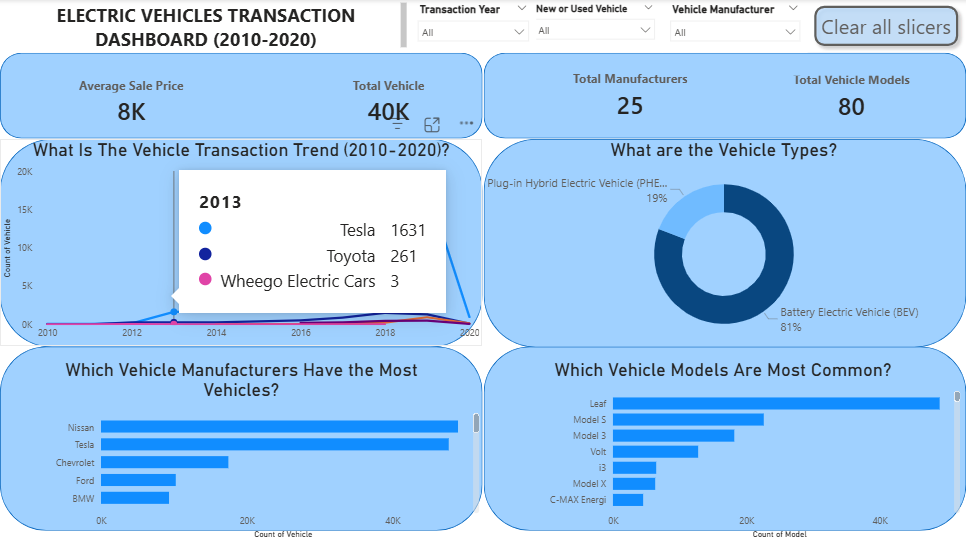

# Vehicle dashboard /Power Bi

## Introduction
This project present an Electric Vehicles Trasaction Dashboard (2010-2020) developed using Microsoft Power Bi to analyze electric vehicle trasaction data over 10-years period. **The goal of this project is to transform raw trasaction data into meaningful insights** that support better understanding of electric vehicle market trends and performance.

The dashboard provides insights into vehicle sales trends, average sales prices, vehicle types, manufacturers and the most common vehicle models. It also features interactive slicers that allows the users to explore the data by trasaction year, vehicle condition (New or used) manufacturer.

## Skills Showcased
- **Data Transformation (ETL) with power Query:** Cleaned, shaped and prapare the raw data for analysis handling blanks, changing data types and creating new columns.
- **Implicit Measures:** Formulated measures to derive key insights and KPIs count of vehicle types as well vehicle models
- **Data Visualisation:** Utilised Bar charts, Line chart and Donut chart used correctly for different insights
- **KPI:** Average sales price, Total Vehicles, Total Manufacturer and total vehicle models
- **Slicers:** Trasaction Year, New or Used Vehicle, Vehicle manufacturer with "Clear all slicers" button
- **Trend Analysis:** Vehicle Trasaction Trend (2010-2020) showing growth and drop
- **Comparison Analysis:** Vehicle types, manufacturer and models comparison
- **Data Interaction:** Identifying top manufacturer and top model

# Conclusion
This project demonstrates the use of Power Bi to transform electric vehicle traction data into meaningful visual insights. It highlights key market trnds, vehicle preferences and manufacturer performance, while showcasing practical data analysis and visualisation skills.